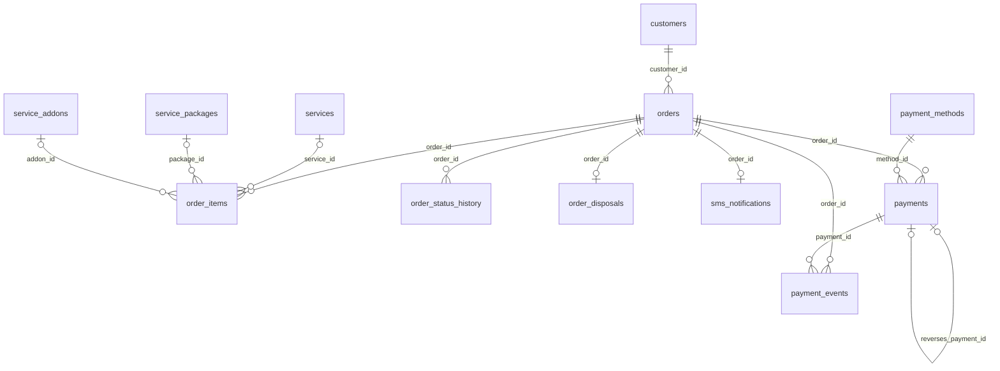
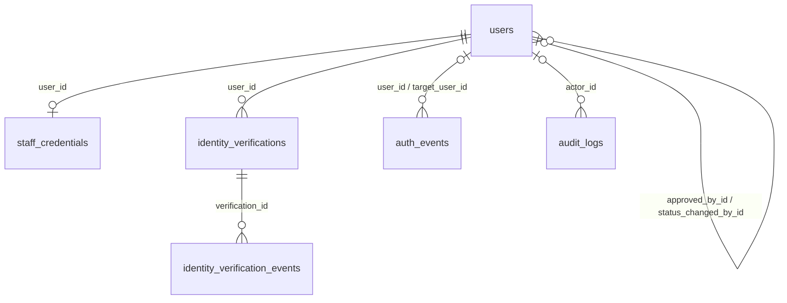

# Laundrix database schema

Generated from the SQLAlchemy models in `app/models/` (21 tables) plus `alembic_version`, which Alembic keeps by itself. Types are shown as MySQL/TiDB types. `PK` = primary key, `FK` = foreign key, `UQ` = unique, `IDX` = indexed. All dates and times are stored as naive UTC.

## Contents

- **Accounts & security**: [`users`](#users), [`staff_credentials`](#staff_credentials), [`auth_events`](#auth_events), [`audit_logs`](#audit_logs), [`identity_verifications`](#identity_verifications), [`identity_verification_events`](#identity_verification_events)
- **Customers & orders**: [`customers`](#customers), [`orders`](#orders), [`order_items`](#order_items), [`order_status_history`](#order_status_history), [`order_disposals`](#order_disposals), [`sms_notifications`](#sms_notifications)
- **Payments**: [`payments`](#payments), [`payment_methods`](#payment_methods), [`payment_settings`](#payment_settings), [`payment_events`](#payment_events)
- **Service catalog**: [`services`](#services), [`service_packages`](#service_packages), [`service_addons`](#service_addons)
- **Analytics**: [`unclaimed_model_runs`](#unclaimed_model_runs), [`historical_transactions`](#historical_transactions)
- **Alembic**: [`alembic_version`](#alembic_version)

## Relationship overview

Core business data (the many `created_by` / `recorded_by` links to `users` are left out of this diagram to keep it readable):

Accounts, security and audit:

`unclaimed_model_runs`, `historical_transactions` and `payment_settings` (only `updated_by_id → users`) stand on their own.

## Accounts & security

### users

Staff and admin accounts (Google sign-in, or username/password for staff). Holds role, approval and lock-out state.  
Model: `User` in `app/models/user.py`

| Attribute | Data type | Null | Keys / constraints | Default |
|---|---|---|---|---|
| `id` | INT | NOT NULL | PK |  |
| `google_sub` | VARCHAR(64) | NULL | UQ |  |
| `email` | VARCHAR(255) | NOT NULL | UQ, IDX |  |
| `full_name` | VARCHAR(150) | NULL |  |  |
| `picture_url` | VARCHAR(500) | NULL |  |  |
| `role` | ENUM(admin, staff) | NOT NULL |  | staff |
| `is_active` | BOOLEAN | NOT NULL |  | True |
| `created_at` | DATETIME | NOT NULL |  | current UTC time |
| `last_login_at` | DATETIME | NULL |  |  |
| `account_status` | VARCHAR(24) | NOT NULL | IDX | active |
| `status_reason` | VARCHAR(255) | NULL |  |  |
| `status_changed_at` | DATETIME | NULL |  |  |
| `status_changed_by_id` | INT | NULL | FK → users.id (ON DELETE SET NULL) |  |
| `approved_at` | DATETIME | NULL |  |  |
| `approved_by_id` | INT | NULL | FK → users.id (ON DELETE SET NULL) |  |
| `username` | VARCHAR(40) | NULL | UQ |  |
| `password_hash` | VARCHAR(255) | NULL |  |  |
| `failed_login_attempts` | INT | NOT NULL |  | 0 |
| `locked_until` | DATETIME | NULL |  |  |

Constraints and indexes:
- CHECK (account_status IN ('pending_verification', 'pending_approval', 'active', 'rejected', 'suspended', 'deactivated')) — `ck_users_account_status`

Relationships:
- `users.status_changed_by_id` → `users.id` (optional): many-to-one, ON DELETE SET NULL
- `users.approved_by_id` → `users.id` (optional): many-to-one, ON DELETE SET NULL
- `users` ← `audit_logs.actor_id`: one-to-many
- `users` ← `auth_events.user_id`: one-to-many
- `users` ← `auth_events.target_user_id`: one-to-many
- `users` ← `customers.created_by_id`: one-to-many
- `users` ← `identity_verifications.user_id`: one-to-many
- `users` ← `order_disposals.disposed_by_id`: one-to-many
- `users` ← `order_status_history.changed_by_id`: one-to-many
- `users` ← `orders.created_by_id`: one-to-many
- `users` ← `orders.received_by_id`: one-to-many
- `users` ← `payment_events.actor_id`: one-to-many
- `users` ← `payment_settings.updated_by_id`: one-to-many
- `users` ← `payments.recorded_by_id`: one-to-many
- `users` ← `staff_credentials.user_id`: one-to-one

### staff_credentials

Staff-portal credentials: password hash, failed-attempt lock-out and one-time enrollment link. One row per staff user.  
Model: `StaffCredential` in `app/models/staff_credential.py`

| Attribute | Data type | Null | Keys / constraints | Default |
|---|---|---|---|---|
| `id` | INT | NOT NULL | PK |  |
| `user_id` | INT | NOT NULL | FK → users.id (ON DELETE CASCADE), UQ |  |
| `staff_id_hash` | VARCHAR(255) | NULL |  |  |
| `password_hash` | VARCHAR(255) | NULL |  |  |
| `enroll_token_hash` | VARCHAR(64) | NULL | UQ |  |
| `enroll_token_expires_at` | DATETIME | NULL |  |  |
| `failed_attempts` | INT | NOT NULL |  | 0 |
| `locked_until` | DATETIME | NULL |  |  |
| `last_verified_at` | DATETIME | NULL |  |  |
| `created_at` | DATETIME | NOT NULL |  | current UTC time |

Relationships:
- `staff_credentials.user_id` → `users.id`: one-to-one, ON DELETE CASCADE

### auth_events

Audit trail of sign-in and account-management activity (no secrets).  
Model: `AuthEvent` in `app/models/auth_event.py`

| Attribute | Data type | Null | Keys / constraints | Default |
|---|---|---|---|---|
| `id` | INT | NOT NULL | PK |  |
| `user_id` | INT | NULL | FK → users.id (ON DELETE SET NULL), IDX |  |
| `target_user_id` | INT | NULL | FK → users.id (ON DELETE SET NULL), IDX |  |
| `detail` | VARCHAR(500) | NULL |  |  |
| `email` | VARCHAR(255) | NULL |  |  |
| `event` | VARCHAR(40) | NOT NULL |  |  |
| `success` | BOOLEAN | NOT NULL |  | False |
| `ip` | VARCHAR(45) | NULL |  |  |
| `user_agent` | VARCHAR(255) | NULL |  |  |
| `created_at` | DATETIME | NOT NULL | IDX | current UTC time |

Relationships:
- `auth_events.user_id` → `users.id` (optional): many-to-one, ON DELETE SET NULL
- `auth_events.target_user_id` → `users.id` (optional): many-to-one, ON DELETE SET NULL

### audit_logs

Append-only audit trail of important business and security actions (who did what, when, from where).  
Model: `AuditLog` in `app/models/audit_log.py`

| Attribute | Data type | Null | Keys / constraints | Default |
|---|---|---|---|---|
| `id` | INT | NOT NULL | PK |  |
| `created_at` | DATETIME | NOT NULL | IDX | current UTC time |
| `actor_id` | INT | NULL | FK → users.id (ON DELETE SET NULL) |  |
| `actor_name` | VARCHAR(150) | NOT NULL |  |  |
| `actor_role` | VARCHAR(20) | NULL |  |  |
| `action` | VARCHAR(40) | NOT NULL |  |  |
| `module` | VARCHAR(40) | NOT NULL |  |  |
| `resource_id` | VARCHAR(64) | NULL |  |  |
| `resource_label` | VARCHAR(150) | NULL |  |  |
| `description` | VARCHAR(500) | NOT NULL |  |  |
| `old_values` | JSON | NULL |  |  |
| `new_values` | JSON | NULL |  |  |
| `success` | BOOLEAN | NOT NULL |  | True |
| `ip_address` | VARCHAR(45) | NULL |  |  |

Constraints and indexes:
- INDEX (module, created_at)
- INDEX (action, created_at)
- INDEX (actor_id, created_at)

Relationships:
- `audit_logs.actor_id` → `users.id` (optional): many-to-one, ON DELETE SET NULL

### identity_verifications

One identity-verification attempt for one user (status only; no ID images or personal data are stored).  
Model: `IdentityVerification` in `app/models/identity_verification.py`

| Attribute | Data type | Null | Keys / constraints | Default |
|---|---|---|---|---|
| `id` | INT | NOT NULL | PK |  |
| `public_id` | VARCHAR(32) | NOT NULL | UQ | _public_id |
| `user_id` | INT | NOT NULL | FK → users.id (ON DELETE CASCADE) |  |
| `purpose` | VARCHAR(16) | NOT NULL |  | kyc |
| `provider` | VARCHAR(20) | NOT NULL |  |  |
| `provider_session_id` | VARCHAR(64) | NULL | UQ |  |
| `environment` | VARCHAR(10) | NOT NULL |  |  |
| `status` | VARCHAR(20) | NOT NULL |  |  |
| `reason_codes` | JSON | NULL |  |  |
| `error_code` | VARCHAR(40) | NULL |  |  |
| `document_type` | VARCHAR(40) | NULL |  |  |
| `consent_version` | VARCHAR(20) | NULL |  |  |
| `consent_at` | DATETIME | NULL |  |  |
| `provider_updated_at` | DATETIME | NULL |  |  |
| `last_polled_at` | DATETIME | NULL |  |  |
| `decided_at` | DATETIME | NULL |  |  |
| `completed_at` | DATETIME | NULL |  |  |
| `created_at` | DATETIME | NOT NULL |  | current UTC time |
| `updated_at` | DATETIME | NOT NULL |  | current UTC time |

Constraints and indexes:
- UNIQUE (public_id) — `uq_identity_verifications_public_id`
- UNIQUE (provider_session_id) — `uq_identity_verifications_session`
- INDEX (user_id)
- INDEX (status)
- INDEX (user_id, purpose)

Relationships:
- `identity_verifications.user_id` → `users.id`: many-to-one, ON DELETE CASCADE
- `identity_verifications` ← `identity_verification_events.verification_id`: one-to-many

### identity_verification_events

Append-only log of status changes for a verification; the unique event_id also de-duplicates provider webhooks.  
Model: `IdentityVerificationEvent` in `app/models/identity_verification.py`

| Attribute | Data type | Null | Keys / constraints | Default |
|---|---|---|---|---|
| `id` | INT | NOT NULL | PK |  |
| `verification_id` | INT | NOT NULL | FK → identity_verifications.id (ON DELETE CASCADE) |  |
| `event_id` | VARCHAR(64) | NULL | UQ |  |
| `source` | VARCHAR(12) | NOT NULL |  |  |
| `provider_status` | VARCHAR(30) | NULL |  |  |
| `from_status` | VARCHAR(20) | NULL |  |  |
| `to_status` | VARCHAR(20) | NULL |  |  |
| `outcome` | VARCHAR(24) | NOT NULL |  |  |
| `created_at` | DATETIME | NOT NULL |  | current UTC time |

Constraints and indexes:
- UNIQUE (event_id) — `uq_identity_verification_events_event_id`
- INDEX (verification_id)

Relationships:
- `identity_verification_events.verification_id` → `identity_verifications.id`: many-to-one, ON DELETE CASCADE

## Customers & orders

### customers

Customers of the shop (name and contact number).  
Model: `Customer` in `app/models/customer.py`

| Attribute | Data type | Null | Keys / constraints | Default |
|---|---|---|---|---|
| `id` | INT | NOT NULL | PK |  |
| `full_name` | VARCHAR(150) | NOT NULL | IDX |  |
| `contact_number` | VARCHAR(30) | NOT NULL |  |  |
| `contact_normalized` | VARCHAR(20) | NOT NULL | IDX |  |
| `created_by_id` | INT | NULL | FK → users.id (ON DELETE SET NULL) |  |
| `created_at` | DATETIME | NOT NULL |  | current UTC time |

Relationships:
- `customers.created_by_id` → `users.id` (optional): many-to-one, ON DELETE SET NULL
- `customers` ← `orders.customer_id`: one-to-many

### orders

Laundry orders: totals, status, payment arrangement, receipt confirmation and SMS consent. Customer name/contact are snapshots at order time.  
Model: `Order` in `app/models/order.py`

| Attribute | Data type | Null | Keys / constraints | Default |
|---|---|---|---|---|
| `id` | INT | NOT NULL | PK |  |
| `reference` | VARCHAR(24) | NOT NULL | UQ |  |
| `tracking_token` | VARCHAR(64) | NOT NULL | UQ | random token |
| `customer_id` | INT | NOT NULL | FK → customers.id (ON DELETE RESTRICT), IDX |  |
| `customer_name` | VARCHAR(150) | NOT NULL |  |  |
| `customer_contact` | VARCHAR(30) | NOT NULL |  |  |
| `status` | VARCHAR(30) | NOT NULL | IDX | order_received |
| `subtotal` | DECIMAL(10, 2) | NOT NULL |  |  |
| `discount_total` | DECIMAL(10, 2) | NOT NULL |  | 0 |
| `total` | DECIMAL(10, 2) | NOT NULL |  |  |
| `notes` | TEXT | NULL |  |  |
| `created_by_id` | INT | NULL | FK → users.id (ON DELETE SET NULL), IDX |  |
| `created_at` | DATETIME | NOT NULL | IDX | current UTC time |
| `updated_at` | DATETIME | NOT NULL |  | current UTC time |
| `payment_arrangement` | VARCHAR(20) | NULL |  |  |
| `received_at` | DATETIME | NULL | IDX |  |
| `received_by_id` | INT | NULL | FK → users.id (ON DELETE SET NULL) |  |
| `submission_token` | VARCHAR(64) | NULL | UQ |  |
| `sms_consent` | BOOLEAN | NOT NULL |  | false |
| `sms_consent_at` | DATETIME | NULL |  |  |

Constraints and indexes:
- CHECK (total >= 0) — `ck_orders_total_nonneg`

Relationships:
- `orders.customer_id` → `customers.id`: many-to-one, ON DELETE RESTRICT
- `orders.created_by_id` → `users.id` (optional): many-to-one, ON DELETE SET NULL
- `orders.received_by_id` → `users.id` (optional): many-to-one, ON DELETE SET NULL
- `orders` ← `order_disposals.order_id`: one-to-one
- `orders` ← `order_items.order_id`: one-to-many
- `orders` ← `order_status_history.order_id`: one-to-many
- `orders` ← `payment_events.order_id`: one-to-many
- `orders` ← `payments.order_id`: one-to-many
- `orders` ← `sms_notifications.order_id`: one-to-one

### order_items

One purchased line on an order (service, package or add-on). Names and prices are snapshots taken at order time.  
Model: `OrderItem` in `app/models/order.py`

| Attribute | Data type | Null | Keys / constraints | Default |
|---|---|---|---|---|
| `id` | INT | NOT NULL | PK |  |
| `order_id` | INT | NOT NULL | FK → orders.id (ON DELETE CASCADE), IDX |  |
| `item_type` | ENUM(service, package, addon) | NOT NULL |  |  |
| `service_id` | INT | NULL | FK → services.id (ON DELETE SET NULL) |  |
| `package_id` | INT | NULL | FK → service_packages.id (ON DELETE SET NULL) |  |
| `addon_id` | INT | NULL | FK → service_addons.id (ON DELETE SET NULL) |  |
| `name` | VARCHAR(160) | NOT NULL |  |  |
| `description` | VARCHAR(255) | NULL |  |  |
| `quantity` | DECIMAL(10, 2) | NOT NULL |  |  |
| `unit` | VARCHAR(20) | NOT NULL |  |  |
| `measurement` | DECIMAL(8, 2) | NULL |  |  |
| `measurement_unit` | VARCHAR(10) | NULL |  |  |
| `unit_price` | DECIMAL(10, 2) | NOT NULL |  |  |
| `line_total` | DECIMAL(10, 2) | NOT NULL |  |  |
| `customer_supplied` | BOOLEAN | NOT NULL |  | False |
| `instructions` | VARCHAR(500) | NULL |  |  |

Constraints and indexes:
- CHECK (unit_price >= 0 AND line_total >= 0 AND quantity > 0) — `ck_items_amounts`

Relationships:
- `order_items.order_id` → `orders.id`: many-to-one, ON DELETE CASCADE
- `order_items.service_id` → `services.id` (optional): many-to-one, ON DELETE SET NULL
- `order_items.package_id` → `service_packages.id` (optional): many-to-one, ON DELETE SET NULL
- `order_items.addon_id` → `service_addons.id` (optional): many-to-one, ON DELETE SET NULL

### order_status_history

Every status change of an order (Order Received → … → Completed) with who changed it and when.  
Model: `OrderStatusHistory` in `app/models/order.py`

| Attribute | Data type | Null | Keys / constraints | Default |
|---|---|---|---|---|
| `id` | INT | NOT NULL | PK |  |
| `order_id` | INT | NOT NULL | FK → orders.id (ON DELETE CASCADE), IDX |  |
| `from_status` | VARCHAR(30) | NULL |  |  |
| `to_status` | VARCHAR(30) | NOT NULL |  |  |
| `changed_by_id` | INT | NULL | FK → users.id (ON DELETE SET NULL) |  |
| `note` | VARCHAR(255) | NULL |  |  |
| `created_at` | DATETIME | NOT NULL | IDX | current UTC time |

Relationships:
- `order_status_history.order_id` → `orders.id`: many-to-one, ON DELETE CASCADE
- `order_status_history.changed_by_id` → `users.id` (optional): many-to-one, ON DELETE SET NULL

### order_disposals

Admin-recorded fact that an unclaimed Ready-for-Pickup order was disposed of. Real outcome data for the prediction model.  
Model: `OrderDisposal` in `app/models/order_disposal.py`

| Attribute | Data type | Null | Keys / constraints | Default |
|---|---|---|---|---|
| `id` | INT | NOT NULL | PK |  |
| `order_id` | INT | NOT NULL | FK → orders.id (ON DELETE CASCADE), UQ |  |
| `disposed_by_id` | INT | NULL | FK → users.id (ON DELETE SET NULL) |  |
| `disposed_at` | DATETIME | NOT NULL |  | current UTC time |

Constraints and indexes:
- UNIQUE (order_id) — `uq_order_disposals_order`

Relationships:
- `order_disposals.order_id` → `orders.id`: one-to-one, ON DELETE CASCADE
- `order_disposals.disposed_by_id` → `users.id` (optional): many-to-one, ON DELETE SET NULL

### sms_notifications

The "ready for pickup" SMS for an order. At most one row per order.  
Model: `SMSNotification` in `app/models/sms.py`

| Attribute | Data type | Null | Keys / constraints | Default |
|---|---|---|---|---|
| `id` | INT | NOT NULL | PK |  |
| `order_id` | INT | NOT NULL | FK → orders.id (ON DELETE RESTRICT), UQ |  |
| `provider` | VARCHAR(20) | NOT NULL |  | unisms |
| `status` | VARCHAR(30) | NOT NULL | IDX | pending |
| `provider_message_id` | VARCHAR(100) | NULL | IDX |  |
| `recipient` | VARCHAR(20) | NULL |  |  |
| `attempt_count` | INT | NOT NULL |  | 0 |
| `last_error` | VARCHAR(255) | NULL |  |  |
| `created_at` | DATETIME | NOT NULL |  | current UTC time |
| `updated_at` | DATETIME | NOT NULL |  | current UTC time |
| `last_attempt_at` | DATETIME | NULL |  |  |
| `accepted_at` | DATETIME | NULL |  |  |
| `provider_sent_at` | DATETIME | NULL |  |  |

Constraints and indexes:
- UNIQUE (order_id) — `uq_sms_notifications_order_id`
- CHECK (status IN ('pending', 'queued', 'retrying', 'sent', 'failed', 'unknown', 'skipped_no_consent', 'skipped_invalid_recipient')) — `ck_sms_notifications_status`

Relationships:
- `sms_notifications.order_id` → `orders.id`: one-to-one, ON DELETE RESTRICT

## Payments

### payments

Append-only payment ledger. A mistake is corrected by a reversal row pointing at the original payment.  
Model: `Payment` in `app/models/payment.py`

| Attribute | Data type | Null | Keys / constraints | Default |
|---|---|---|---|---|
| `id` | INT | NOT NULL | PK |  |
| `order_id` | INT | NOT NULL | FK → orders.id (ON DELETE RESTRICT), IDX |  |
| `kind` | ENUM(payment, reversal) | NOT NULL |  | payment |
| `method_id` | INT | NOT NULL | FK → payment_methods.id (ON DELETE RESTRICT), IDX |  |
| `method_code` | VARCHAR(30) | NOT NULL |  |  |
| `method_label` | VARCHAR(60) | NOT NULL |  |  |
| `amount` | DECIMAL(10, 2) | NOT NULL |  |  |
| `reference` | VARCHAR(64) | NULL |  |  |
| `paid_at` | DATETIME | NOT NULL | IDX | current UTC time |
| `recorded_by_id` | INT | NULL | FK → users.id (ON DELETE SET NULL), IDX |  |
| `notes` | VARCHAR(255) | NULL |  |  |
| `reverses_payment_id` | INT | NULL | FK → payments.id (ON DELETE RESTRICT), UQ |  |
| `idempotency_key` | VARCHAR(100) | NULL | UQ |  |
| `created_at` | DATETIME | NOT NULL |  | current UTC time |

Constraints and indexes:
- CHECK (amount > 0) — `ck_payments_amount_positive`
- CHECK ((kind = 'payment' AND reverses_payment_id IS NULL) OR (kind = 'reversal' AND reverses_payment_id IS NOT NULL)) — `ck_payments_kind_link`

Relationships:
- `payments.order_id` → `orders.id`: many-to-one, ON DELETE RESTRICT
- `payments.method_id` → `payment_methods.id`: many-to-one, ON DELETE RESTRICT
- `payments.recorded_by_id` → `users.id` (optional): many-to-one, ON DELETE SET NULL
- `payments.reverses_payment_id` → `payments.id` (optional): one-to-one, ON DELETE RESTRICT
- `payments` ← `payment_events.payment_id`: one-to-many

### payment_methods

Admin-configurable ways to pay (Cash, GCash, ...).  
Model: `PaymentMethod` in `app/models/payment.py`

| Attribute | Data type | Null | Keys / constraints | Default |
|---|---|---|---|---|
| `id` | INT | NOT NULL | PK |  |
| `code` | VARCHAR(30) | NOT NULL | UQ |  |
| `label` | VARCHAR(60) | NOT NULL |  |  |
| `is_active` | BOOLEAN | NOT NULL |  | True |
| `requires_reference` | BOOLEAN | NOT NULL |  | False |
| `sort_order` | INT | NOT NULL |  | 100 |
| `created_at` | DATETIME | NOT NULL |  | current UTC time |
| `updated_at` | DATETIME | NOT NULL |  | current UTC time |

Relationships:
- `payment_methods` ← `payments.method_id`: one-to-many

### payment_settings

Single-row table (id = 1) with payment policy and the text shown to customers.  
Model: `PaymentSettings` in `app/models/payment.py`

| Attribute | Data type | Null | Keys / constraints | Default |
|---|---|---|---|---|
| `id` | INT | NOT NULL | PK |  |
| `partial_enabled` | BOOLEAN | NOT NULL |  | True |
| `pay_later_enabled` | BOOLEAN | NOT NULL |  | True |
| `gcash_account_name` | VARCHAR(120) | NULL |  |  |
| `gcash_account_number` | VARCHAR(40) | NULL |  |  |
| `payment_instructions` | TEXT | NULL |  |  |
| `payment_notice` | VARCHAR(255) | NULL |  |  |
| `stub_footer` | VARCHAR(255) | NULL |  |  |
| `show_qr_on_stub` | BOOLEAN | NOT NULL |  | False |
| `qr_filename` | VARCHAR(80) | NULL |  |  |
| `updated_by_id` | INT | NULL | FK → users.id (ON DELETE SET NULL) |  |
| `updated_at` | DATETIME | NOT NULL |  | current UTC time |

Relationships:
- `payment_settings.updated_by_id` → `users.id` (optional): many-to-one, ON DELETE SET NULL

### payment_events

Audit trail of payment activity and payment-settings changes.  
Model: `PaymentEvent` in `app/models/payment.py`

| Attribute | Data type | Null | Keys / constraints | Default |
|---|---|---|---|---|
| `id` | INT | NOT NULL | PK |  |
| `order_id` | INT | NULL | FK → orders.id (ON DELETE SET NULL), IDX |  |
| `payment_id` | INT | NULL | FK → payments.id (ON DELETE SET NULL), IDX |  |
| `actor_id` | INT | NULL | FK → users.id (ON DELETE SET NULL), IDX |  |
| `action` | VARCHAR(40) | NOT NULL | IDX |  |
| `detail` | VARCHAR(500) | NULL |  |  |
| `ip` | VARCHAR(45) | NULL |  |  |
| `created_at` | DATETIME | NOT NULL | IDX | current UTC time |

Relationships:
- `payment_events.order_id` → `orders.id` (optional): many-to-one, ON DELETE SET NULL
- `payment_events.payment_id` → `payments.id` (optional): many-to-one, ON DELETE SET NULL
- `payment_events.actor_id` → `users.id` (optional): many-to-one, ON DELETE SET NULL

## Service catalog

### services

Individual laundry services (Wash, Dry, Fold, ...) with price and billing unit.  
Model: `Service` in `app/models/catalog.py`

| Attribute | Data type | Null | Keys / constraints | Default |
|---|---|---|---|---|
| `id` | INT | NOT NULL | PK |  |
| `code` | VARCHAR(40) | NOT NULL | UQ |  |
| `name` | VARCHAR(120) | NOT NULL |  |  |
| `category` | VARCHAR(80) | NOT NULL | IDX | Laundry service |
| `description` | VARCHAR(255) | NULL |  |  |
| `price` | DECIMAL(10, 2) | NOT NULL |  |  |
| `pricing_unit` | ENUM(load, kg, piece) | NULL |  |  |
| `is_active` | BOOLEAN | NOT NULL | IDX | True |
| `icon_key` | VARCHAR(30) | NOT NULL |  | generic |
| `image_url` | VARCHAR(500) | NULL |  |  |
| `created_at` | DATETIME | NOT NULL |  | current UTC time |
| `updated_at` | DATETIME | NOT NULL |  | current UTC time |

Constraints and indexes:
- CHECK (price >= 0) — `ck_services_price_nonneg`

Relationships:
- `services` ← `order_items.service_id`: one-to-many

### service_packages

Wash-Dry-Fold packages priced by weight or piece range.  
Model: `ServicePackage` in `app/models/catalog.py`

| Attribute | Data type | Null | Keys / constraints | Default |
|---|---|---|---|---|
| `id` | INT | NOT NULL | PK |  |
| `name` | VARCHAR(120) | NOT NULL |  | Wash, Dry & Fold |
| `category` | VARCHAR(80) | NOT NULL | IDX |  |
| `description` | VARCHAR(120) | NOT NULL |  |  |
| `size_label` | VARCHAR(40) | NULL |  |  |
| `measure_type` | ENUM(weight, pieces) | NOT NULL |  |  |
| `min_value` | DECIMAL(8, 2) | NOT NULL |  |  |
| `max_value` | DECIMAL(8, 2) | NOT NULL |  |  |
| `price` | DECIMAL(10, 2) | NOT NULL |  |  |
| `covers_codes` | VARCHAR(120) | NOT NULL |  | wash,dry,fold |
| `is_active` | BOOLEAN | NOT NULL | IDX | True |
| `icon_key` | VARCHAR(30) | NOT NULL |  | package |
| `image_url` | VARCHAR(500) | NULL |  |  |
| `created_at` | DATETIME | NOT NULL |  | current UTC time |
| `updated_at` | DATETIME | NOT NULL |  | current UTC time |

Constraints and indexes:
- UNIQUE (category, description) — `uq_package_category_description`
- CHECK (price >= 0) — `ck_packages_price_nonneg`
- CHECK (min_value > 0 AND max_value >= min_value) — `ck_packages_range`

Relationships:
- `service_packages` ← `order_items.package_id`: one-to-many

### service_addons

Optional products/extras such as Fabcon or Liquid Soap.  
Model: `ServiceAddon` in `app/models/catalog.py`

| Attribute | Data type | Null | Keys / constraints | Default |
|---|---|---|---|---|
| `id` | INT | NOT NULL | PK |  |
| `code` | VARCHAR(40) | NOT NULL | UQ |  |
| `name` | VARCHAR(120) | NOT NULL |  |  |
| `description` | VARCHAR(255) | NULL |  |  |
| `price` | DECIMAL(10, 2) | NOT NULL |  |  |
| `is_chargeable` | BOOLEAN | NOT NULL |  | True |
| `allow_customer_supplied` | BOOLEAN | NOT NULL |  | True |
| `is_active` | BOOLEAN | NOT NULL | IDX | True |
| `icon_key` | VARCHAR(30) | NOT NULL |  | generic |
| `image_url` | VARCHAR(500) | NULL |  |  |
| `created_at` | DATETIME | NOT NULL |  | current UTC time |
| `updated_at` | DATETIME | NOT NULL |  | current UTC time |

Constraints and indexes:
- CHECK (price >= 0) — `ck_addons_price_nonneg`

Relationships:
- `service_addons` ← `order_items.addon_id`: one-to-many

## Analytics

### unclaimed_model_runs

Saved versions of the unclaimed-order disposal-risk model (weights and metrics as JSON).  
Model: `UnclaimedModelRun` in `app/models/unclaimed_model_run.py`

| Attribute | Data type | Null | Keys / constraints | Default |
|---|---|---|---|---|
| `id` | INT | NOT NULL | PK |  |
| `version` | INT | NOT NULL | UQ |  |
| `is_active` | BOOLEAN | NOT NULL |  | False |
| `algorithm` | VARCHAR(40) | NOT NULL |  |  |
| `features` | JSON | NOT NULL |  |  |
| `params` | JSON | NOT NULL |  |  |
| `metrics` | JSON | NOT NULL |  |  |
| `n_orders` | INT | NOT NULL |  |  |
| `n_disposed` | INT | NOT NULL |  |  |
| `data_start` | DATE | NULL |  |  |
| `data_end` | DATE | NULL |  |  |
| `disposal_days` | INT | NOT NULL |  |  |
| `labels_simulated` | BOOLEAN | NOT NULL |  | False |
| `data_source` | VARCHAR(20) | NOT NULL |  | imported |
| `trained_at` | DATETIME | NOT NULL |  | current UTC time |

Constraints and indexes:
- UNIQUE (version) — `uq_unclaimed_model_runs_version`

Relationships:
- none (stands alone)

### historical_transactions

Imported historical transactions from a CSV (used only by the `flask analytics import-history` command).  
Model: `HistoricalTransaction` in `app/models/historical_transaction.py`

| Attribute | Data type | Null | Keys / constraints | Default |
|---|---|---|---|---|
| `id` | INT | NOT NULL | PK |  |
| `transaction_date` | DATE | NOT NULL |  |  |
| `source_transaction_no` | INT | NOT NULL |  |  |
| `customer_name` | VARCHAR(150) | NULL |  |  |
| `raw_weight` | VARCHAR(30) | NULL |  |  |
| `fold_amount` | DECIMAL(10, 2) | NOT NULL |  | 0 |
| `liquid_soap_amount` | DECIMAL(10, 2) | NOT NULL |  | 0 |
| `surf_downy_amount` | DECIMAL(10, 2) | NOT NULL |  | 0 |
| `load_amount` | DECIMAL(10, 2) | NOT NULL |  | 0 |
| `total_amount` | DECIMAL(10, 2) | NOT NULL |  |  |
| `payment_status` | VARCHAR(20) | NOT NULL |  | unknown |
| `ready_date` | DATE | NULL |  |  |
| `outcome_status` | VARCHAR(20) | NOT NULL |  | unknown |
| `claimed_date` | DATE | NULL |  |  |
| `disposed_date` | DATE | NULL |  |  |
| `status_source` | VARCHAR(20) | NOT NULL |  | unknown |
| `import_source` | VARCHAR(255) | NOT NULL |  |  |
| `source_row_key` | VARCHAR(191) | NOT NULL | UQ |  |
| `created_at` | DATETIME | NOT NULL |  | current UTC time |

Constraints and indexes:
- UNIQUE (import_source, transaction_date, source_transaction_no) — `uq_historical_source_date_no`
- INDEX (transaction_date)
- UNIQUE (source_row_key) — `uq_historical_transactions_source_row_key`

Relationships:
- none (stands alone)

### alembic_version

Managed by Alembic; records which migration the database is at. Required for `flask db upgrade`.

| Attribute | Data type | Null | Keys / constraints | Default |
|---|---|---|---|---|
| `version_num` | VARCHAR(32) | NOT NULL | PK | |

Relationships: none.
